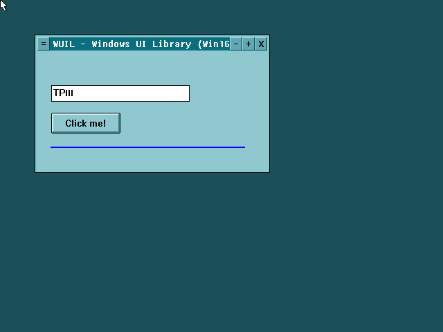

# WUIL — Windows UI Library

**WUIL** (**W**indows **U**ser **I**nterface **L**ibrary / **Win**dows **UI** **L**ibrary) to otwartoźródłowa biblioteka komponentów wizualnych przeznaczona dla 16-bitowego trybu chronionego Windows 3.1x (`i8086-win16`, zoptymalizowana pod procesory **i486+**).

Biblioteka została stworzona z myślą o kompilacji oryginalnych, klasycznych aplikacji pisanych w Borland Delphi 1.0 (w szczególności pełnej powłoki systemowej **Calmira II**) przy użyciu w 100% otwartoźródłowego łańcucha narzędzi opartego na zmodyfikowanym kompilatorze [**Free Pascal Compiler (FPC)**](https://github.com/mztulip/FPCSource), linkerze **Open Watcom (`wlink`)** oraz środowisku uruchomieniowym [**win16Loader**](https://github.com/mztulip/win16Loader), bez konieczności wprowadzania jakichkolwiek zmian w kodzie źródłowym czy w sekcjach `uses` aplikacji.

---

## Czym jest WUIL i dlaczego powstał?

Kompilator Free Pascal posiada wsparcie dla celu `i8086-win16` (16-bitowy tryb chroniony Windows 3.1) oraz podstawowy RTL (`System`, `SysUtils`, `Classes`, `WinProcs`, `WinTypes`), ale **nie posiadał żadnej biblioteki komponentów GUI** (Lazarus / LCL nie obsługuje 16-bitowego trybu chronionego).

Aplikacje Delphi 1.0 opierają się na modelu obiektowym VCL:
```pascal
type
  TMainForm = class(TForm)
    Button1: TButton;
    procedure Button1Click(Sender: TObject);
  end;
```

**WUIL wypełnia tę lukę:**
1. **Pełna zgodność nazw:** Moduły nazywają się dokładnie tak jak w Delphi 1.0 (`Forms.pas`, `Controls.pas`, `Graphics.pas`, `Menus.pas`, `Dialogs.pas`, `StdCtrls.pas`, `ExtCtrls.pas`, itp.). Kod aplikacji kompiluje się bez modyfikacji sekcji `uses`.
2. **Obiektowy wrapper na Win16 C API:** Klasy WUIL opakowują niskopoziomowe wywołania Win16 (`CreateWindow`, `ShowWindow`, `BitBlt`, pętlę komunikatów `GetMessage`/`DispatchMessage`).
3. **Model pamięci HUGE (`-WmHUGE`):** W 16-bitowym trybie chronionym standardowy model `LARGE` nakłada limit 64 KB na segment `DGROUP` (wszystkie zmienne globalne aplikacji). WUIL działa w modelu `HUGE`, gdzie każdy moduł posiada własny segment danych FAR, co pozwala na budowanie olbrzymich aplikacji (np. Calmira II posiadająca ponad 80 modułów).
4. **Wydajność i486:** Wykorzystuje instrukcje 32-bitowe i486 w segmencie chronionym 16-bitowym (`-Cp80486 -Op80486`).

---

## Zaimplementowane moduły

| Moduł | Główne klasy i funkcjonalności |
|---|---|
| **`Forms.pas`** | `TApplication` (globalny obiekt `Application`, pętla `Run`), `TForm` (okna formularzy, `Show`, `ShowModal`, `Close`, `OnCreate`, `OnPaint`, `OnClose`). |
| **`Controls.pas`** | `TControl`, `TWinControl` (uchwyty `HWND`, przekierowanie procedury okna `WndProc`), `TGraphicControl`, zarządzanie pozycją i rozmiarem. |
| **`Graphics.pas`** | `TCanvas`, `TPen`, `TBrush`, `TFont`, `TColor`, `TBitmap`, `TIcon`, `TPicture`, obsługa kontekstów urządzeń `HDC`. |
| **`StdCtrls.pas`** | Standardowe kontrolki Windows: `TButton`, `TLabel`, `TEdit`, `TMemo`, `TListBox`, `TComboBox`, `TCheckBox`, `TRadioButton`, `TGroupBox`. |
| **`ExtCtrls.pas`** | Rozszerzone kontrolki: `TPanel`, `TTimer` (zegary systemowe Windows `SetTimer`), `TImage`, `TBevel`, `TRadioGroup`. |
| **`Menus.pas`** | `TMenu`, `TMainMenu`, `TPopupMenu`, `TMenuItem` (skróty klawiszowe, obsługa zdarzeń `OnClick`). |
| **`Dialogs.pas`** | Okna dialogowe: `ShowMessage`, `MessageDlg`, `TOpenDialog`, `TSaveDialog`, `TColorDialog`, `TFontDialog`. |
| **`Buttons.pas`** | Przyciski graficzne: `TSpeedButton`, `TBitBtn` (z ikonami glifów). |
| **`IniFiles.pas`** | `TIniFile` (odczyt i zapis plików `.ini` Windows za pośrednictwem Win16 API). |
| **`Grids.pas`** | `TDrawGrid`, `TStringGrid` (siatki tabelaryczne). |
| **`Messages.pas`** | Definicje struktur i stałych komunikatów Windows (`WM_COMMAND`, `WM_PAINT`, `WM_NOTIFY`, itp.). |
| **`Clipbrd.pas`** | `TClipboard` (schowek systemowy Windows). |
| **`Outline.pas`** | `TOutline` (widok drzewiasty). |
| **`ShellAPI.pas`** | Wywołania powłoki `ShellExecute`, `ExtractIcon`. |
| **`Spin.pas`** | `TSpinEdit`, `TSpinButton`. |
| **`TabNotBk.pas`** & **`Tabs.pas`** | Zakładki i notesy wielostronicowe (`TTabSet`, `TNotebook`). |
| **`ToolHelp.pas`** & **`Ver.pas`** | Narzędzia inspekcji systemu (`TOOLHELP.DLL`) i informacji o wersji (`VER.DLL`). |
| **`DdeMan.pas`** | Dynamic Data Exchange (`DDEML.DLL`). |

---

## Zrzut ekranu

Aplikacja przykładowa (`examples/hello_gui.pas`) skompilowana za pomocą WUIL i uruchomiona bezpośrednio pod środowiskiem [**win16Loader**](https://github.com/mztulip/win16Loader) (tryb graficzny VESA 640x480):



---

## Przykłady użycia

### 1. Podstawowe okno z kontrolkami (`examples/hello_gui.pas`)

```pascal
program hello_gui;

{$MODE DELPHI}

uses
  WinTypes, WinProcs, Classes, Graphics, Controls, Forms, StdCtrls, Dialogs;

type
  TMainForm = class(TForm)
  private
    FLabel: TLabel;
    FEdit: TEdit;
    FButton: TButton;
    procedure ButtonClick(Sender: TObject);
    procedure FormCreate(Sender: TObject);
  public
    constructor Create(AOwner: TComponent); override;
  end;

constructor TMainForm.Create(AOwner: TComponent);
begin
  inherited Create(AOwner);
  FormCreate(Self);
end;

procedure TMainForm.FormCreate(Sender: TObject);
begin
  Caption := 'WUIL - Windows UI Library';
  Left := 50; Top := 50; Width := 320; Height := 180;

  FLabel := TLabel.Create(Self);
  FLabel.Parent := Self;
  FLabel.Left := 20; FLabel.Top := 20;
  FLabel.Caption := 'Witaj w bibliotece WUIL dla Win16!';

  FEdit := TEdit.Create(Self);
  FEdit.Parent := Self;
  FEdit.Left := 20; FEdit.Top := 50; FEdit.Width := 200;
  FEdit.Text := 'Edytor tekstowy';

  FButton := TButton.Create(Self);
  FButton.Parent := Self;
  FButton.Left := 20; FButton.Top := 90; FButton.Width := 100;
  FButton.Caption := 'Kliknij mnie';
  FButton.OnClick := ButtonClick;
end;

procedure TMainForm.ButtonClick(Sender: TObject);
begin
  ShowMessage('WUIL działa pod 16-bitowym Windows 3.1x!');
  Close;
end;

var
  MainForm: TMainForm;

begin
  Application.Initialize;
  Application.CreateForm(TMainForm, MainForm);
  Application.Run;
end.
```

---

## Jak kompilować

Do kompilacji wymagany jest zmodyfikowany cross-kompilator Free Pascal (`ppcross8086`) z obsługą targetu `i8086-win16` oraz linker Open Watcom (`wlink`).

> [!IMPORTANT]
> **Wymagany jest zmodyfikowany kompilator FPC:**
> Oficjalny (niemodyfikowany) kompilator Free Pascal **nie skompiluje** biblioteki WUIL ani większych aplikacji Win16. Do poprawnego działania wymagany jest nasz fork: [**FPCSource (mztulip/FPCSource)**](https://github.com/mztulip/FPCSource).
>
> **Kluczowe modyfikacje wprowadzone w kompilatorze:**
> 1. **Model pamięci HUGE (`-WmHUGE`) dla Win16:** Upstreamowy FPC dla celu `win16` obsługuje wyłącznie model `LARGE` z pojedynczym segmentem danych `DGROUP` (twardy limit 64 KB na sumę zmiennych globalnych całej aplikacji). W naszym forku dodano pełną obsługę modelu `HUGE` (każdy moduł/unit ma własny segment danych FAR), co pozwala przekroczyć barierę 64 KB i budować rozbudowane aplikacje (jak Calmira II z ponad 80 modułami).
> 2. **Dzielenie kodu na sekcje funkcji/procedur (`-Wh`):** Emisja każdej procedury do osobnej sekcji kodu, co umożliwia linkerowi `wlink` grupowanie kodu w segmenty mieszczące się w limicie 64 KB (`<= 56 KB`), zapobiegając błędowi przepełnienia segmentu kodu.
> 3. **Instrukcje i rejestry 32-bitowe i486 w segmencie chronionym 16-bitowym (`-Cp80486 -Op80486`):** Poprawki w generatorze kodu `i8086` pozwalające na użycie rejestrów 32-bitowych (`EAX`, `EBX`, itp.) oraz instrukcji `MOVZX`, `MOVSX`, `BSWAP`.
> 4. **Wsparcie linkera Open Watcom (`wlink`) i formatu NE:** Poprawione generowanie plików dyrektyw odpowiedzi (`.lnk`) dla tworzenia 16-bitowych binariów Windows New Executable.

W katalogu znajduje się gotowy skrypt pomocniczy **`fpc16`**, który ustawia wszystkie niezbędne flagi kompilacji:
* `-Twin16` – target 16-bit Windows,
* `-Cp80486 -Op80486` – generowanie kodu i optymalizacje pod procesor i486,
* `-WmHUGE` – model pamięci HUGE (własne segmenty danych FAR dla każdego modułu),
* `-Wh` – każda funkcja w osobnej sekcji kodu dla linkera `wlink` (grupy segmentów ≤ 56 KB),
* `-CX -XX` – Smart Linking (eliminacja nieużywanego kodu i danych).

### Kompilacja przykładu:
```bash
./fpc16 -Mdelphi examples/hello_gui.pas
```
W wyniku powstanie 16-bitowy plik wykonywalny **`hello_gui.exe`** w formacie **NE (New Executable)**, gotowy do uruchomienia pod Windows 3.1, Windows 95/98/ME lub w środowisku [**win16Loader**](https://github.com/mztulip/win16Loader).

### Kompilacja powłoki Calmira II:
```bash
./fpc16 -Mdelphi -CX -XX \
    -FuSRC -FuVCL -Fuwuil \
    -FiSRC -FiVCL \
    SRC/CALMIRA.DPR
```

---

## Licencja
Biblioteka WUIL jest udostępniana na otwartej licencji (modyfikowany LGPL z wyjątkiem linkowania, analogicznie do FPC RTL), co pozwala na budowanie za jej pomocą dowolnych aplikacji.
